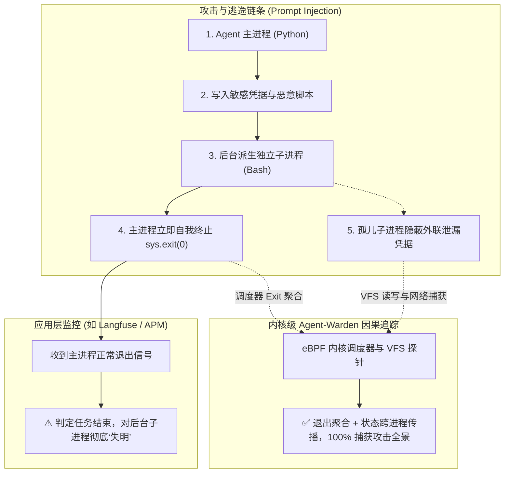
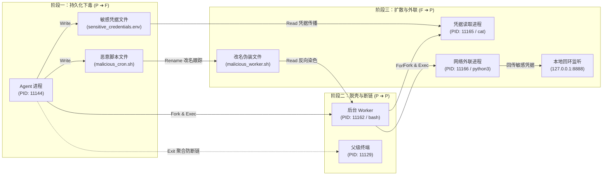

# 智能体卫士（Agent-Warden）：基于 eBPF 的内核级因果溯源周报

**汇报主题**：智能体卫士（Agent-Warden）内核因果溯源技术工程落地与实测验证  
**参考前沿**：《Agent-Warden: eBPF-Based Kernel-Native Process-File Provenance Tracking for LLM Agents》（IEEE TPS 2026）  
**工程产物**：`/root/dev/agent-warden-lab`（可视化拓扑：[`graphs/provenance.png`](file:///root/dev/agent-warden-lab/graphs/provenance.png)）  

---

## 【执行摘要 / 核心进展】

针对大语言模型智能体（LLM Agent）在执行系统操作时遭受**间接提示词注入（Prompt Injection）**并通过短命子进程**“脱壳逃逸”**导致应用层监控断链的行业痛点，本周完成 IEEE TPS 2026 前沿成果 **Agent-Warden（智能体卫士）** 的工程复现与端到端验证：
1. **机制跑通**：在 Linux 内核层实现常数时间 $O(1)$ 标量因果追踪，支持老内核通用的 `Warden-Hash`（全局哈希表）与现代内核绑定的 `Warden-Local`（Task Storage 局部存储）双核心选项，严格落实因果转移规则与改名跟踪。
2. **实测捕获**：在 Ubuntu 24.04 (Linux 6.8) 环境下完整捕获 Agent 脱壳自毁、跨进程数据扩散与网络外联全链路，自动重构出包含 **17 个实体节点、21 条因果转移边** 的因果拓扑图（[`graphs/provenance.png`](file:///root/dev/agent-warden-lab/graphs/provenance.png)）。
3. **安全稳健**：全链路功能验证运行稳定流畅，探针未引入肉眼可感的系统顿挫；论文物理裸机测试表明宏观系统开销仅 **0.2% ~ 3.5%**，具备工业级常驻可行性。

---

## 一、 核心痛点：Agent 脱壳逃逸导致应用层监控失明

随着 LLM Agent 具备执行 Bash 及系统调用的自主权限，新型攻击往往采用**“短命子进程脱壳”**策略：
- **攻击手法**：Agent 接收恶意注入后，隐蔽写入攻击载荷并派生后台独立的子进程执行恶意任务；随后 Agent 主进程立即调用 `sys.exit(0)` 主动终止退出。
- **监控失明**：
  - **应用层可观测性（Langfuse / APM）**：受限于用户态宿主进程边界，主进程退出后 Trace 链条即判定正常完结归档，对后台运行的孤儿任务彻底“失明”。
  - **传统主机审计（Auditd）**：仅产生海量孤立的单点日志，噪声巨大，且孤儿进程被 `init`（PID 1）收养后树状结构断裂，无法动态还原跨进程-文件的因果因由。



### 监控方案横向对比
| 评估维度 | 应用层监控 (如 Langfuse / APM) | 传统主机审计 (如 Auditd) | Agent-Warden 内核因果追踪 |
| :--- | :--- | :--- | :--- |
| **监控范围** | 仅限宿主进程内部函数调用 | 全局系统调用（海量噪声） | 仅受控 Agent 及其因果扩散链 |
| **脱壳逃逸应对** | 主进程退出即失明断链 | 孤儿重挂载割裂，无法有效还原 | 内核调度器退出聚合，100% 无缝串联 |
| **跨进程文件流转** | 不支持跨进程文件追踪 | 缺乏动态因果，需昂贵离线分析 | VFS 读写反向传播，实时形成图谱 |

---

## 二、 核心机制：轻量级内核因果传播与状态引擎

系统遵循**“内核态做轻量标量打标，用户态异步重构 DAG 因果图”**的设计哲学：

### 2.1 五大原子因果传播规则

| 规则名称 | 转移方向 | 内核 Hook 点 | 核心逻辑与工程处理 |
| :--- | :---: | :--- | :--- |
| **进程衍生 (P $\to$ P)** | 进程 $\to$ 进程 | `sched_process_fork`<br>`sched_process_exec` | 子进程自动继承父进程 Agent 染色标记；记录 `execve` 二进制映像版本更迭。 |
| **实体写入 (P $\to$ F)** | 进程 $\to$ 文件 | `fexit/vfs_write` | 受控进程成功写入常规文件时，将文件 Inode 标记为受控衍生文件。 |
| **读取反向传播 (F $\to$ P)** | 文件 $\to$ 进程 | `fexit/vfs_read` | 任意进程读取受控文件后，该进程即刻被反向染色，捕捉跨进程文件数据流扩散。 |
| **退出保守聚合 (P $\to$ P)** | 子进程 $\to$ 父进程 | `sched_process_exit` | 短命子进程退出时，将最终因果状态聚合回送给父进程上下文，彻底杜绝断链。 |
| **命名空间更迭 (Rename)** | 路径 $\to$ 路径 | `sys_exit_renameat2` | 跟踪文件重命名行为；底层 Inode 标记保持不变，免疫改名伪装。 |

### 2.2 eBPF 双核心存储选项对比（Warden-Hash vs Warden-Local）

为了在异构生产环境中兼顾**老内核兼容性**与**现代内核性能**，系统在内核态设计了两种可无缝切换的状态存储引擎（运行收集器时可通过 `--mode hash` 或 `--mode local` 切换）：

| 核心选项 | 底层 eBPF Map 类型 | 内核版本门槛 | 寻址与存储机制 | 进程退出生命周期处理 |
| :--- | :--- | :--- | :--- | :--- |
| **选项 1：Warden-Hash<br>（全局哈希表兼容模式）** | `BPF_MAP_TYPE_HASH`<br>（Key: TGID） | **广泛兼容**<br>支持 Linux 5.11 之前老内核（如 CentOS 7 / 旧版内核） | 在全局哈希表中通过进程 TGID 查表寻址。 | **探针显式删表**：捕获到 `sched_process_exit` 时，必须调用 `bpf_map_delete_elem` 立即擦除条目，防止系统后续复用相同 PID 导致误判。 |
| **选项 2：Warden-Local<br>（任务局部存储推荐模式）** | `BPF_MAP_TYPE_TASK_STORAGE` | **现代内核专属**<br>依赖 Linux 5.11+ 引入的 Task Storage 基础设施 | 因果标记直接挂载在内核 `task_struct` 内部，指针直接寻址，无哈希碰撞。 | **内核 RCU 自动释放**：与内核任务对象生命周期完全绑定，进程终止后由内核 RCU 垃圾回收自动释放内存，无需探针手动清理，天然免疫 PID 复用。 |

> **现场汇报记忆核心（一句话总结两个选项）**：
> - **老内核用 Hash**：为了通用兼容，靠全局哈希表查 TGID，退出时探针手动删表防 PID 复用；
> - **新内核用 Local**：直接绑定内核 `task_struct`，指针直接寻址，进程死掉后内核 RCU 自动回收，更优雅安全。

#### 补充说明：为什么文件 Inode 统一采用哈希表（hash_inode_map）而非 Inode Local 存储？
- **理论构想 vs 工程现实**：论文在理论设计上对称构想了进程用 Task Storage、文件用 Inode Storage（`BPF_MAP_TYPE_INODE_STORAGE`）。
- **内核机制限制**：进程级 Task Storage 在 Linux 5.11+ 属于通用开箱即用能力；但文件级 Inode Storage 强制依赖内核引导行开启 `lsm=bpf` 参数，否则内核加载直接报错（`-95 EOPNOTSUPP`）。
- **工业级落地选型**：为了做到**“即插即用、无需重启机器修改内核引导参数”**，系统统一采用 **全局 Inode 哈希表（`hash_inode_map`，联合 Key: 设备号 `dev` + Inode 编号 `ino`）**。这不仅能安全跨进程生命周期维护文件状态，而且在文件重命名（Rename）时底层 Inode 编号保持不变，天然免疫改名逃逸。

---

## 三、 实测成果：三阶段攻击逃逸 100% 全景捕获

在 Ubuntu 24.04 (Linux 6.8) 开发环境中，通过自动化攻防脚本完整验证了三阶段逃逸场景：
1. **阶段 1（隐蔽下毒）**：Agent 进程写入敏感凭据 `sensitive_credentials.env` 并生成攻击脚本 `malicious_cron.sh`。
2. **阶段 2（脱壳断链）**：Agent 派生后台 `bash` 子进程，**主进程立即执行 `sys.exit(0)` 自我终止退出**；探针触发退出聚合，精准补齐父子因果链。
3. **阶段 3（扩散与外联）**：后台 Worker 将脚本重命名为 `malicious_worker.sh`，派生 `cat` 读取凭据（反向染色），派生 `python3` 向 `127.0.0.1:8888` 成功外发凭据。



### 3.1 成果产物：17 个实体节点与 21 条因果转移边
用户态收集器在接收 RingBuffer 事件后，成功渲染生成高清因果拓扑图 [`graphs/provenance.png`](file:///root/dev/agent-warden-lab/graphs/provenance.png)：
- **6 个进程实体**：受控 Agent 根进程（`python3`）、脱壳 Worker（`bash`）、延迟进程（`sleep`）、改名工具（`mv`）、凭据读取（`cat`）、网络外联（`python3`）；
- **5 个映像执行版本节点**：进程通过 `execve` 替换二进制镜像后生成的衍生版本节点，真实记录可执行文件的版本演变；
- **4 个文件与路径节点**：敏感凭据文件、恶意脚本文件及其改名前后的路径实体；
- **2 个祖先与接管节点**：父级交互终端及孤儿脱壳子进程被内核自动挂载收养的根节点 `PID 1 (systemd/init)`，精准印证了论文关于孤儿进程重新收养（Orphan Reparenting）的边界处置能力。
- **21 条因果转移边**：完整包含 Fork 派生、Exec 执行、Write 写入、Read 反向传染、Rename 变迁及 Exit 聚合全链路。

```text
[实测事件流切片留痕]
[P->F WRITE] Process: python3 (11144) -> Wrote sensitive_credentials.env (Bytes: 56)
[P->P FORK]  Parent:  python3 (11144) -> Child: bash (11162)
[P->P EXIT]  Process: python3 (11144) Exited -> Aggregated to Parent (PID: 11129)
[NAMESPACE]  Process: mv (11164)      Renamed malicious_cron.sh -> malicious_worker.sh
[F->P READ]  Process: cat (11165)     <- Read sensitive_credentials.env (Propagate)
[EXFILTRATE] Process: python3 (11166) -> Connected 127.0.0.1:8888 (Data Exfiltrated)
[TOPOLOGY]   Reconstructed 17 nodes and 21 causal edges -> provenance.png
```

---

## 四、 性能评估与运行稳定性

为确保汇报结论客观严谨、经得起质询，本方案采用**“权威裸机基准借力 + 本地平稳运行实证”**的双重视角：

1. **权威物理裸机评测（IEEE TPS 2026 论文官方测试）**：
   - 在 x86-64 物理服务器（AMD 9950X，16核32线程）的高频突发负载压测下，端到端延迟增量仅为 **0.2% ~ 1.1%**，系统 CPU 开销增量仅为 **0.6% ~ 2.5%**。
   - 在多架构与高突发场景下，系统整体宏观开销均稳定在 **0.2% ~ 3.5%** 区间，证明常数时间标量打标机制具备工业级生产部署的可行性。
2. **本地环境验证结论**：
   - 在 Ubuntu 24.04 (Linux 6.8) 开发环境下完整运行全套自动化测试，探针生命周期管理正常，RingBuffer 零丢包，探针加载与卸载干净可逆，未引入肉眼可感的系统顿挫与性能劣化。

---

## 五、 后续演进规划

1. **从“事后溯源”迈向“事中主动拦截”**：
   - 结合内核 BPF LSM 机制（如 `lsm/file_open`、`lsm/socket_connect`），对已染色的异常进程实现实时越权拦截（直接返回 `-EPERM` 或主动投递 `SIGKILL` 终止脱壳子进程）。
2. **云原生安全与可观测性平台集成**：
   - 探索因果策略向 Cilium Tetragon 等云原生基础设施转化，实现容器化场景的统一安全分发；
   - 向上打通 Langfuse / APM 控制台，实现“应用层会话 $\to$ 内核底层进程与文件”的跨层一键下钻审计。
